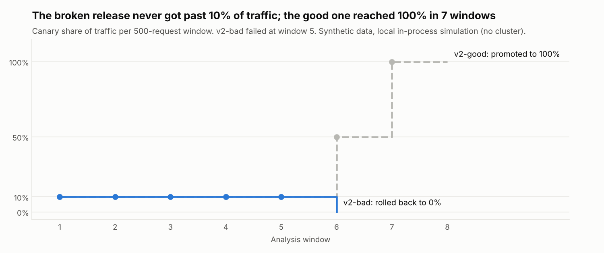
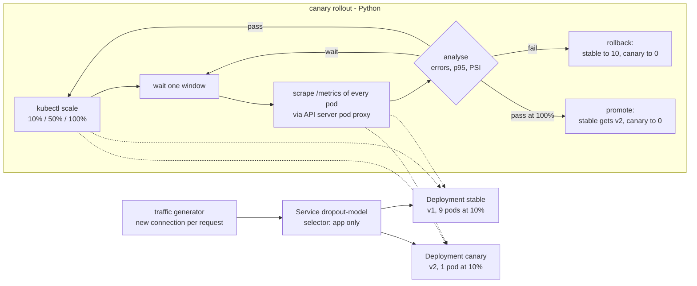
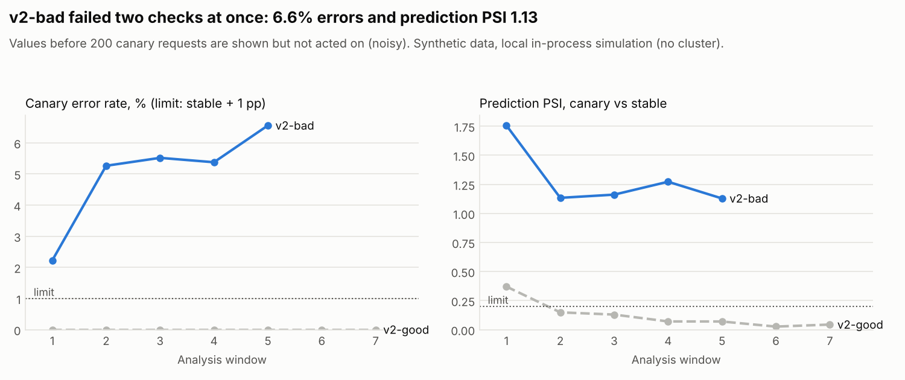

# Canary model rollouts on Kubernetes with automatic rollback


How do you ship a new model version to production without risking all users if it is worse?
This repo answers with a small, complete setup: a FastAPI model server with Prometheus metrics,
Kustomize manifests for a stable and a canary track, and a Python canary controller that moves
traffic 10% → 50% → 100%. At every step it compares the canary with stable (error rate, p95
latency, prediction drift as PSI) and promotes or rolls back on its own. A kind cluster in CI runs
the whole loop twice: a good release must be promoted and a broken one rolled back.

**What this project shows**

- A rollout that limits the blast radius: in the local simulation the broken release served
  244 requests (about 10% of traffic) before it was rolled back; the good release reached 100%.
- Decision logic as pure, tested functions: metric snapshots in, `wait` / `pass` / `fail` out,
  with tests for every threshold boundary and for "not enough traffic yet".
- Kubernetes basics done properly: liveness vs readiness probes, resource requests and limits,
  non-root read-only containers, Kustomize base + overlays, a replica-ratio traffic split
  without a service mesh.
- A model bug that offline metrics cannot see. v2-bad has the same weights as v2-good, but its
  serving code swaps two features and crashes on students with zero enrolled units. Only
  production signals catch it.
- Drift monitoring with PSI on inputs and outputs against the training reference.

I built this after the University of Helsinki MOOCs **DevOps with Docker** and
**DevOps with Kubernetes**, to apply what they teach (images, Deployments, Services, probes,
rolling updates) to a machine learning release problem.



## Problem

A school wants an early-warning model for student dropout. The current model (v1) works. The
data team has a new version (v2). Offline numbers look slightly better, but offline numbers
do not show serving bugs: a feature passed in the wrong order, an input the new code cannot
handle, a slower dependency. If v2 goes straight to 100% and is broken, every student and
teacher sees wrong risk scores or errors. A canary sends the new version a small share of real
traffic first, measures it next to the old version, and only then decides.

## Architecture



Step-by-step explanation of the code: **[docs/how-it-works.md](docs/how-it-works.md)**.
Why each choice was made: **[docs/decisions.md](docs/decisions.md)**.
What to do when an alert fires: **[docs/runbook.md](docs/runbook.md)**.

## Quick start

```bash
python -m venv .venv && source .venv/bin/activate
make install
make train                       # models/v1.joblib, v2-good.joblib, v2-bad.joblib
canary serve --version v1        # API on :8000, docs on :8000/docs
```

```bash
curl -X POST localhost:8000/predict -H 'content-type: application/json' -d '{
  "age_at_enrollment": 19, "scholarship_holder": 0, "debtor": 0, "tuition_up_to_date": 1,
  "sem1_enrolled": 6, "sem1_approved": 5, "sem1_grade": 13.2}'
# {"model_version":"v1","dropout_risk":0.103,"high_risk":false}
curl localhost:8000/metrics | grep canary_
```

Rollouts without a cluster (in-process servers, same controller code):

```bash
canary rollout --local v2-good   # exit 0, promoted
canary rollout --local v2-bad    # exit 3, rolled back
canary drift --shift 1.0         # PSI per feature vs the training reference
canary report                    # regenerates docs/results.md and the charts
```

On a real cluster (needs docker, kind, kubectl): `make e2e` runs [scripts/e2e.sh](scripts/e2e.sh),
the same script CI runs.

## Results

From `canary report`: **synthetic data and a local in-process simulation, not a cluster.**
The effects are planted on purpose (see [docs/results.md](docs/results.md) for every window).

| Model | ROC AUC (synthetic test set) | Requests that fail |
| --- | --- | --- |
| v1 (stable) | 0.838 | 0.0% |
| v2-good | 0.842 | 0.0% |
| v2-bad (same weights as v2-good, broken serving code) | 0.798 | 6.1% |

| Release | Outcome | Decided at | Canary requests when decided | Canary errors | Prediction PSI vs stable |
| --- | --- | --- | --- | --- | --- |
| v2-good | **promoted** | 10% → 50% → 100% (7 windows) | 244 / 246 / 500 | 0.00% | 0.070 / 0.026 / 0.044 |
| v2-bad | **rolled back** | 10%, window 5 | 244 | 6.56% | 1.129 |

Two things worth noticing:

- In the first window the good release had a PSI of 0.371 on 45 requests, above the 0.2 limit.
  The controller waited for 200 requests per side, and the PSI fell to 0.070. Without the
  minimum, a good release would have been rolled back on noise.
- Latency in the simulation is measured inside one process (about 5 ms p95 for both), so the
  latency check runs but proves nothing about a real cluster.



## Design decisions (summary)

- **Replica-ratio canary, no service mesh:** one Service selects both Deployments; traffic
  follows the pod count. Simple and portable, but coarse (10 replicas → 10% steps) and not
  sticky per user. Limits and alternatives are in [docs/decisions.md](docs/decisions.md).
- **Metrics straight from pods:** the controller reads `/metrics` through the API server pod
  proxy, so the e2e test needs no Prometheus install.
- **Stable baseline = all stable traffic since the rollout began**, canary = this step only.
- **Wait before judging:** 200 requests per side; on-the-limit values pass; not enough traffic
  after N windows rolls back instead of hanging.
- **Promote by copying the version into the stable Deployment**, so the end state is always
  "stable has all replicas, canary has 0".
- **Models baked into the image at build time** with a fixed seed; the version is an env var.

## Project layout

```
src/canary_serving/
  data.py       synthetic students (UCI schema) and the real UCI loader
  model.py      train v1 / v2-good, derive v2-bad, serving-side feature assembly
  server.py     FastAPI: /predict /healthz /readyz /metrics
  metrics.py    Prometheus metrics, text parsing, per-pod window deltas
  analysis.py   pure decision logic: wait / pass / fail
  drift.py      PSI and the drift report
  rollout.py    controller loop and the replica split
  kube.py       kubectl backend (scale, pod-proxy scrape, promote, rollback)
  simulate.py   in-process backend for the local simulation
  traffic.py    traffic generator
  report.py     docs/results.md and charts
  cli.py        canary train | serve | traffic | rollout | drift | report
k8s/base, k8s/overlays/{stable,canary}, k8s/shared, k8s/e2e
scripts/e2e.sh  kind end-to-end test (CI and local)
docs/           how-it-works, decisions, runbook, results, charts
tests/          58 test functions (72 cases), 96% coverage
```

## Testing and quality

- **Unit tests** for the decision logic (wait at 199 requests, pass at 200, error-rate and PSI
  limits exactly on the boundary, latency needing both a relative and an absolute gap), PSI
  maths, Prometheus parsing, counter resets and pods that come and go.
- **Contract tests** for the server: response schema, probes, 422/500/503 paths, and the exact
  metric lines `/metrics` exports.
- **Controller tests** with a fake backend and a fake `kubectl` (scale order, pod-proxy paths,
  promote and rollback sequences).
- **Manifest tests** render the overlays (`kustomize build` when installed, otherwise a small
  Python renderer) and check names, labels, probes, resources and security settings.
- **Simulation tests**: the real servers and controller promote v2-good and roll back v2-bad.
- **CI**: ruff, mypy, pytest with an 80% coverage gate, `kubectl kustomize`; a Docker build with
  a container smoke test; and an e2e job on kind (`helm/kind-action@v1.12.0`) that must promote
  v2-good and roll back v2-bad.

Not run where this repo was built: Docker and kind (no daemon in that sandbox). Those parts are
checked by the CI jobs only.

## What I'd do next

- Use Prometheus and PromQL instead of scraping pods, and alert rules from the runbook.
- Argo Rollouts or Flagger with ingress-nginx weights for exact percentages, header-based
  routing for internal testers, and sticky sessions.
- Write the promoted version back to Git (GitOps) so `kubectl apply -k` cannot undo a promotion.
- Shadow traffic: send a copy of requests to the canary without returning its answers.
- Label feedback: compare canary and stable precision once real dropout outcomes arrive.

Data: synthetic, generated by `canary_serving.data.generate`. The schema follows seven columns of
the UCI dataset [Predict Students' Dropout and Academic Success](https://archive.ics.uci.edu/dataset/697)
(Realinho et al., CC BY 4.0); `load_uci` reads the real file. Check its current terms before use.
